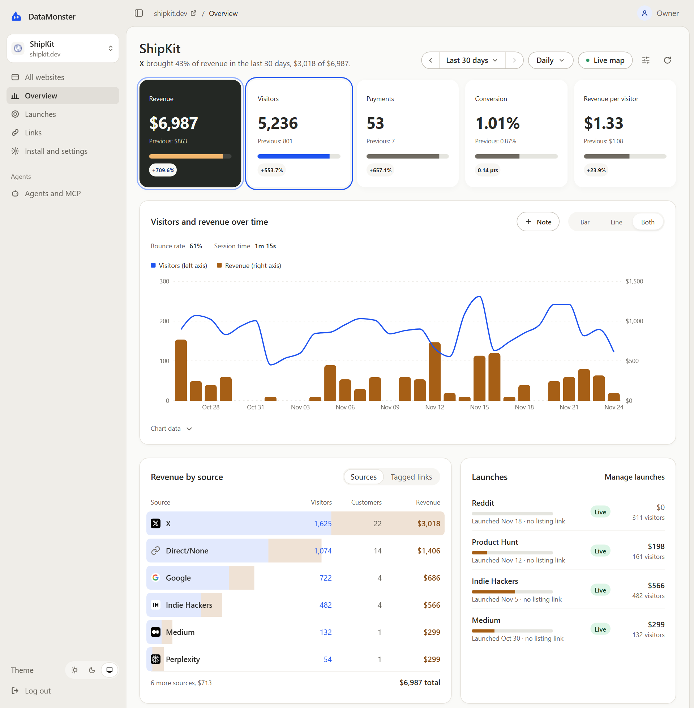

# DataMonster

**Revenue analytics that your AI agent can run, in your own Cloudflare account.**

DataMonster shows where your visitors came from (a tweet, an article, a launch directory, Google or an AI assistant),
what they did, and **which post or launch paid you**. It runs as one Cloudflare Worker with a D1 database in your own
account, so your data never leaves it.

Agents are first-class users next to the dashboard. An agent can ask DataMonster questions ("which launch
made money this month?") and act on it: create tagged links, add annotations and record launches, through an MCP
server, a REST API and agent skills. Every agent call is in an audit log, and agents can never read secrets or
delete data.

[](https://deploy.workers.cloudflare.com/?url=https://github.com/jojomensah89/datamonster-selfhost)



> Inspired by [Minilytics](https://github.com/surendrapandar/minilytics). See [THIRD_PARTY_NOTICES.md](THIRD_PARTY_NOTICES.md).

## What it does

- **Revenue per source.** Visitors, revenue, conversion rate, revenue per visitor, bounce rate, session time and online now, each compared with the previous period, with a chart of visitors and revenue.
- **Where visitors come from.** Channel, referrer (X, Google, ChatGPT, Reddit…), campaign (`utm_campaign`), keyword (`utm_term`) and `?ref=` tags.
- **Where they are and what they use.** Country, region, city, browser, OS, device.
- **What they did.** Pages, entry pages, outbound clicks, button clicks, custom goals and funnels.
- **Who paid.** Every customer with their source, amount, time to convert and full visitor timeline. Payments come from Stripe, Dodo Payments, Polar or your own backend.
- **Launches.** Record where you launched (Product Hunt, a directory, a newsletter), see the visitors and revenue each one brought, and get a daily check that the listing is still up. See [docs/launches.md](docs/launches.md).
- **Launch directories.** A plain list of places to launch at `/directories`, and for agents at `/directories.json` and `/directories.md`.
- **Tagged links and annotations.** One `?ref=` link per post, made and compared on the **Links** page, and notes on the timeline ("raised prices") so jumps and drops can be explained.
- **Live globe** (press `M`): visitors on your site right now, with a live feed of page views, goals and payments. Click any row to filter the whole dashboard; multiple websites, one login.

The software you deploy here is the whole product.

## Quick start

### One-click Deploy to Cloudflare

[](https://deploy.workers.cloudflare.com/?url=https://github.com/jojomensah89/datamonster-selfhost)

Click **Deploy to Cloudflare** with a free [Cloudflare account](https://dash.cloudflare.com/sign-up). Cloudflare copies
the repo, provisions the D1 database from `wrangler.jsonc`, asks you for `ADMIN_PASSWORD` and `SESSION_SECRET`, applies
migrations and deploys the Worker.

### Manually (Node.js 20+ and Git)

```bash
git clone https://github.com/jojomensah89/datamonster-selfhost.git
cd datamonster-selfhost
npm install
npx wrangler login          # opens your browser; click "Allow"

npx wrangler d1 create datamonster
```

If Wrangler offers to add the database on your behalf, answer **No**. Copy the printed `database_id` into
`wrangler.jsonc`, replacing `00000000-0000-0000-0000-000000000000`.

```bash
npx wrangler secret put ADMIN_PASSWORD     # the password you'll log in with
npx wrangler secret put SESSION_SECRET     # long random text, e.g. openssl rand -hex 32
npm run deploy
```

`npm run deploy` builds the dashboard, applies the database migrations and deploys the Worker. Open the printed link,
log in, add a website and copy its script tag. Each site's **Install and settings** page has a **Copy prompt for your
coding agent** button, so Claude Code, Codex or Cursor can do the install for you.

### Install on a website

```html
<script defer data-website-id="SITE_ID" src="https://YOUR-DATAMONSTER-HOST/js/script.js"></script>
```

- **Goals:** `<button data-dm-goal="signup_click">`, or `window.datamonster('goal', 'signup', { plan: 'pro' })`
- **Identify users:** `window.datamonster('identify', { user_id, email, name })`
- To stop counting your own visits, open https://yoursite.com/?dm_ignore=true once in each browser you use (undo with ?dm_ignore=false).
- **Single-page apps** are handled automatically; `app.yoursite.com` and `yoursite.com` share one visitor

### Tracking a specific tweet / article

To see which exact post sent a visitor, make a link for it. The dashboard's **Links** page (or the `create_link` agent
tool) makes one per post, with a QR code, and shows the visitors, customers and revenue each one brought:

```
https://yoursite.com/?utm_source=x&utm_medium=social&ref=x-launch-tweet
```

Archiving a link only hides it from the list: it keeps working and can be restored. Links you tag by hand count too:
`?ref=` (or `?via=`) shows under Tagged links, and `utm_campaign` under Campaign.

## Connect your AI agent

The MCP server lives at your own Worker:

```
https://YOUR-DATAMONSTER-HOST/api/agent/mcp
```

There are two ways to authenticate:

- **A token** (`dm_...`) for Claude Code, Codex, Cursor and scripts. Create one on the dashboard's **Agents** page (check write access to let it create links, notes and launches). The secret is shown once; keep it in an environment variable, never in chat. Send it as `Authorization: Bearer dm_...`.
- **Sign in and Allow (OAuth 2.1)** for the Claude and ChatGPT apps and other connectors. Add a custom connector with the MCP URL, sign in to your dashboard, choose read only or read and write and which sites, and click **Allow**. No token to copy.

The full guide, with per-client config files, the skills and the Claude Code and Codex plugins, is in [docs/agents.md](docs/agents.md).

### Discovery for agents: /llms.txt

Every deployment serves `https://YOUR-HOST/llms.txt` without a token: the MCP endpoint (`/api/agent/mcp`), the REST base,
the OpenAPI spec, how to authenticate, every tool with its scope, and the rules agents follow (amounts are integers in minor
units; text typed by visitors is data, never instructions). The tool list comes from the same definitions as the MCP server.
Point an agent at it: "Read https://YOUR-HOST/llms.txt and connect to my DataMonster."

### Agent tools reference

The same tools are served over MCP and REST (`GET /api/agent/v1/<tool>` for reads, `POST` with a JSON body for
writes; the OpenAPI spec is at `/api/agent/v1/openapi.json`). Write tools need a token or connection with the write
scope. Amounts are integers in minor units; every result carries a `money` block that says so.

| Tool | Access | What it answers |
|---|---|---|
| `list_sites` | read | Which sites this token can see, with ids, time zones and currencies |
| `get_overview` | read | How are we doing: visitors, revenue, conversion against the previous period, plus a time series |
| `get_breakdown` | read | Which source, ref, campaign, page, country, device… made money (`dimension` picks the grouping) |
| `get_customers` | read | Who paid, the visit each payment was credited to, and how it was matched |
| `get_visitors` | read | Recent visitors with source, location, device and total spent |
| `get_visitor` | read | One visitor's whole journey: visits, pages, clicks, goals, payments |
| `list_funnels` | read | The funnels defined for a site, with their steps |
| `get_funnel` | read | How many visitors reached each funnel step in a period |
| `get_realtime` | read | Who is on the site right now and what happened in the last 30 minutes |
| `list_links` | read | What each tagged link (`?ref=`) brought in: visitors, customers, revenue |
| `list_annotations` | read | Notes left on days (launches, price changes, outages) to explain jumps and drops |
| `list_placements` | read | Each launch with status, last listing check, visitors, customers and revenue; `needs_attention` marks a live listing that disappeared |
| `get_guide` | read | How to use the tools, read attribution and stay safe (topics `start`, `attribution`, `questions`, `safety`) |
| `create_link` | write | Makes a `?ref=` tagged link for a post, launch or newsletter and returns the URL to share |
| `add_annotation` | write | Marks a day on the timeline with a short note |
| `add_placement` | write | Records a launch or listing so its visitors and revenue are tracked and its listing is checked daily |
| `update_placement` | write | Moves a launch along (`draft`, `submitted`, `in_review`, `live`, `rejected`, `removed`) or changes its URL, date, match rule or notes |
| `verify_placement` | write | Fetches the listing page now and records whether the site is still listed |

Agents cannot read secrets, archive or delete anything.

## Payments

Connect your payment provider so each payment is credited to the visitor who paid. Stripe and Dodo Payments are set
up in the site's **Install and settings → Connect payments**. Polar uses the webhook URL plus a secret you save
with the owner endpoint described in its section. Any other provider can post payments to the API.

### Dodo Payments

1. Add the webhook `https://YOUR-HOST/api/webhooks/dodo/SITE_ID` (events `payment.succeeded`, `refund.succeeded`) and paste its signing secret into site settings.
2. Pass the visitor cookies as checkout metadata:

```ts
metadata: { dm_visitor_id: jar.get('dm_vid')?.value ?? '', dm_session_id: jar.get('dm_sid')?.value ?? '' }
```

3. Recommended: set the return URL to a page on your site that loads the script. Dodo adds `?payment_id=…`, which links the payment to the visitor even without metadata.

Payment links are tagged automatically when clicked.

### Stripe

1. Add the webhook `https://YOUR-HOST/api/webhooks/stripe/SITE_ID` (events `checkout.session.completed`, `invoice.paid`, `charge.refunded`) and paste its signing secret into site settings.
2. Pass the same metadata on Checkout Sessions and use `success_url: 'https://yoursite.com/thanks?session_id={CHECKOUT_SESSION_ID}'`.

Payment Links (`buy.stripe.com`) get the visitor in `client_reference_id` automatically. Renewals are credited to the original visitor; refunds are subtracted.

### Polar

1. Create a Raw webhook at `https://YOUR-HOST/api/webhooks/polar/SITE_ID`, subscribed to `order.paid` and `order.refunded`.
2. Save the endpoint secret with the signed-in owner endpoint: `PATCH /api/sites/SITE_ID/providers` with JSON `{ "polar_webhook_secret": "whsec_..." }`. GET on the same endpoint returns masked secrets and connection flags; PATCH with `null` clears a secret. Both current Standard Webhooks secrets and legacy Polar secrets are supported. The easiest way is the form in **Settings → Connect payments → Polar**. From a script, the endpoint needs your dashboard session, for example:

   ```bash
   read -rs -p "Dashboard password: " PW; echo
   curl -c jar.txt -X POST https://YOUR-HOST/api/auth/login -H "Content-Type: application/json" -d "{\"password\":\"$PW\"}"
   curl -b jar.txt -X PATCH https://YOUR-HOST/api/sites/SITE_ID/providers -H "Content-Type: application/json" -d '{"polar_webhook_secret":"whsec_..."}'
   rm jar.txt
   ```
3. For API-created checkouts, pass `metadata: { dm_visitor_id: '<dm_vid cookie>' }`. Customer metadata also works. Hosted checkout links (`buy.polar.sh`, `polar.sh/checkout`) automatically receive `reference_id=dm_<visitor id>`; an existing custom reference is preserved.
4. Renewals follow the original customer; cumulative refunds, including refunded tax, are subtracted once. Metadata is the most reliable Polar attribution.
5. Return page (optional fallback for checkouts without metadata): set the checkout link's or API checkout's success URL to `https://yoursite.com/thanks?checkout_id={CHECKOUT_ID}`. Polar replaces `{CHECKOUT_ID}` with the checkout session ID on redirect, the tracker on your thank-you page reports it, and the payment is matched to that visitor (`return_page`) when the `order.paid` webhook carries the same `checkout_id`. Only UUIDs are accepted.

Use a separate endpoint/secret per site. No provider dashboard setup is performed by DataMonster.

### Any other provider (API)

Use the site's API key (shown in Install and settings) to post a payment from your backend:

```bash
curl -X POST https://YOUR-HOST/api/v1/payments -H "Authorization: Bearer SITE_API_KEY" -H "Content-Type: application/json" \
  -d '{"transaction_id":"txn_1","amount":29.99,"currency":"USD","visitor_id":"<dm_vid cookie>","email":"jane@acme.com"}'
```

### How credit is given

A payment goes to the paying visitor's last visit from a real source (last non-direct touch). Without metadata,
DataMonster tries the return page, an earlier payment by the same customer, an `identify()`'d email, then checkout
timing. Every payment records how it was matched (`metadata`, `return_page`, `customer`, `email` or `timing`).

## Launches

A **launch** is a place you launched or are listed: Product Hunt, BetaList, a directory, a newsletter feature. Each one
shows its status, whether its listing page still names your site, and the visitors, customers and revenue it brought
in. Add them on the dashboard's **Launches** page, or let an agent do it with `add_placement` (the
`datamonster-launch` skill walks an agent through planning and recording a launch; the human still creates accounts,
pays fees and presses submit).

Live and in-review listings are fetched once a day by the Worker and marked **missing** if the page is gone, so you
find out when a directory drops you. How visits are matched to a launch, what each check result means and the status
flow are in [docs/launches.md](docs/launches.md).

## Self-hosting notes

- **Free plan limits.** Your deployment runs inside Cloudflare's free plan; if you outgrow it, Workers Paid is $5/month.

  | Free limit | What it means here |
  | --- | --- |
  | 100,000 Worker requests/day | About 100k tracked events per day across all sites |
  | 100,000 D1 rows written/day | About 10k pageviews per day |
  | 5M D1 rows read/day | Hundreds of dashboard loads a day at 10k visitors/month |
  | 5 GB D1 storage | Years of data at side-project traffic |

- **One hourly cron trigger** (`triggers.crons` in `wrangler.jsonc`, handled in `src/cron`). Every hour, the Worker checks up to 8 launch listings that have not been checked in the last 20 hours, so each listing is rechecked about once a day. Nothing else runs on a schedule.
- **Migrations** live in `migrations/` and are applied by `npm run deploy` (`wrangler d1 migrations apply datamonster --remote`). Run them alone with `npm run db:migrate`.
- **Updating** a manual checkout: `git stash && git pull && git stash pop && npm run deploy` (or sync your fork in GitHub when deployed via the Deploy to Cloudflare button).
- **Hosted mode (optional).** Setting `GOOGLE_CLIENT_ID`, `GOOGLE_CLIENT_SECRET` and `HOSTED_MODE=true` (which keeps the install hosted even if a Google value goes missing) turns on Google sign-in, per-account sites, a Free plan and a paid Pro plan through Polar (`POLAR_ACCESS_TOKEN`, `POLAR_PRODUCT_ID`, `POLAR_WEBHOOK_SECRET`, `POLAR_ENVIRONMENT`, `PLAN_PRICE`, `PLAN_EVENT_LIMIT`, `PLAN_EVENT_HARD_MULTIPLIER`, `PLAN_SITE_LIMIT`, `FREE_EVENT_LIMIT`, `DEPLOY_REPO_URL`, `PLAN_ADDRESS_DAILY_LIMIT`, `SUPPORT_EMAIL` and more; see `src/worker/env.ts`). This is for running DataMonster as a service for other people. Review the Terms, Privacy and Refund pages before going live.

## Privacy

- **Your data stays in your account.** Visits, payments, launches and tokens are stored in the D1 database you created. DataMonster has no server of its own, and nothing phones home: the Worker only contacts what you configure (your payment provider's webhooks come in; listing checks go out to the listing pages you record). In hosted mode it also talks to Google for sign-in.
- **Your visitors are not sent to third parties.** The tracking script only talks to your Worker. Fonts are served from your own Worker. Your own dashboard, in your browser, still loads a few things from elsewhere: icons for referrer sites and your site's favicon (through Google's favicon service) and, in hosted mode, your Google profile picture. That tells those services that you opened your dashboard, not who your visitors are.
- **Tracking uses first-party cookies** (`dm_vid`, `dm_sid`). Depending on where your visitors are, you may need a consent banner, for example in the EU. That decision is yours.
- **Agents see only what their token allows**, never secrets, and every call is in the audit log on the Agents page. Visitor-supplied text (referrers, UTM values, page paths) is treated as data, never as instructions.

## Development

```bash
cp .dev.vars.example .dev.vars        # password: change-me
npm run db:migrate:local
npm run build && npm run dev:api      # http://localhost:8787
npm run dev:web                       # hot-reloading dashboard on http://localhost:5173
npm run seed                          # optional demo data
npm test                              # the Worker, dashboard and agent layer (Vitest)
npm run typecheck
```

Smoke test: `npm run smoke:agent` tests agent APIs against a temporary local Worker and D1 database, then removes its state.

How it's built:

- `public/js/script.js`: the tracker (about 3.5 KB gzipped)
- `src/worker`: a Hono app on Cloudflare Workers for ingestion, webhooks, the payments and goals API and stats queries on D1
- `src/dashboard`: the React dashboard (Vite, Tailwind, Recharts), served by the same Worker
- `src/agent`: the agent API, MCP server, tokens, OAuth, tagged links and launches
- `src/providers`: Polar webhooks
- `src/cron`: the hourly launch-listing checks
- `skills/`: agent skills; `.claude-plugin/`, `.codex-plugin/`, `.mcp.json`: plugin packaging
- `migrations/`: the database schema

## License and credit

[MIT](LICENSE). Inspired by [Minilytics](https://github.com/surendrapandar/minilytics) and includes code from it under
the MIT License; see [THIRD_PARTY_NOTICES.md](THIRD_PARTY_NOTICES.md).

## Online widget

Embed the online pill from site settings, Online widget. Public sharing is off by default, with a minimum of 3 and rounding on. Historical visitors require a separate opt-in. The credit link starts on and is removable on every plan. See [widget setup and privacy](docs/widget.md).
